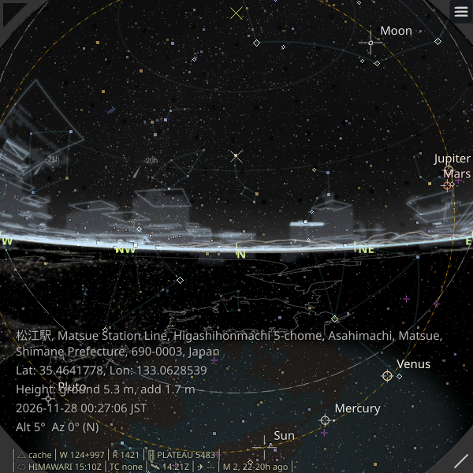

# zstarview

You are standing on an Earth made of glass.

Above you are the stars, the Sun, the Moon, and the planets, seen through
today's sky color and clouds, with aircraft and artificial satellites passing
overhead. Around you are the terrain and buildings of the place you chose.
Below your feet, through the ground, you can see the far side of the Earth and
the stars that are under the horizon.

**Zenith Star View** is a desktop app that puts you on this glass Earth, at any
place you choose, right now or at any other moment.

<p align="center"></p>

## Installation

### 1. Install zstarview

zstarview is intended to be installed with [`pipx`](https://pypa.github.io/pipx/):

```bash
pipx install zstarview
```

To upgrade later:

```bash
pipx upgrade zstarview
```

Linux x86_64 is the primary tested platform. zstarview is routinely tested on
CPython 3.11, 3.12, 3.13, and 3.14.

### 2. Install the `overturemaps` CLI

Building outlines (urban outlines) are enabled by default, and `zstarview`
does not start if the `overturemaps` CLI cannot be found. Install it the same
way:

```bash
pipx install overturemaps
```

On Windows Arm64, `overturemaps` cannot currently be installed with `pipx`; see the
[Windows Arm64 instructions](https://github.com/tos-kamiya/zstarview#2-urban-outline-data-overturemaps).
You can also skip this step and run without building outlines by starting
with `-u 0`, or by setting `Urban outline opacity` to 0 in the startup dialog.

### 3. First run

```bash
zstarview-gui
```

This opens the startup dialog. In the `Location` tab, select `City` and press
`Auto Search` to fill in your current location, then start the viewer.

Map, terrain, building, and cloud data are downloaded on demand and cached
locally, so the first view of a new place can take a while.

### 4. Optional data

These are not downloaded automatically:

- Coastline data: `zstarview-download-coastline --all`
  ([details](https://github.com/tos-kamiya/zstarview#3-optional-coastline-data))
- AKARI far-infrared sky layer: `zstarview-download-akari-ir-bands`
  ([details](https://github.com/tos-kamiya/zstarview#optional-akari-ir-bands-data))
- PLATEAU building data (some Japanese cities):
  `zstarview-download-plateau-buildings`
  ([details](https://github.com/tos-kamiya/zstarview#plateau-building-data-preparation))

## Usage

The package provides three main commands:

- `zstarview-gui`: opens the startup dialog, then the viewer.
- `zstarview`: opens the viewer directly, configured by command-line options.
- `zstarview-export-image`: renders one image without opening a window, to a
  file or to a sixel-capable terminal.

Examples:

```bash
zstarview Tokyo
zstarview                            # detect the current location (default)
zstarview last                       # reuse the previous location
zstarview --offline                  # no network; use cached data only
zstarview "Tokyo Skytree"
zstarview "35.68;139.76" --datetime "2025-09-12 21 JST"
zstarview Tokyo -A 90                # look up at the zenith
zstarview Tokyo -a 0.4               # show nearby aircraft
zstarview-export-image Matsue -o matsue.png
```

Image exports must start at least 60 seconds apart; concurrent exports are not
supported. For debugging, `--debug-ignore-export-cooldown` bypasses this check.

See the [CLI reference](https://github.com/tos-kamiya/zstarview#cli-reference)
for all options and the
[GUI operations](https://github.com/tos-kamiya/zstarview#gui) for keyboard and
mouse controls.

## What it shows

- **Sky**: stars, the Sun, the Moon, planets, deep-sky objects, asterisms, and
  guide lines, including the parts below the horizon.
- **Atmosphere**: sky color from a scattering model, real-time satellite cloud
  imagery, and optional aircraft, artificial satellites, tropical cyclones,
  meteor trails, and forecast precipitation.
- **Ground**: terrain horizon, building outlines, water surfaces, night lights,
  and the far side of the Earth seen through the ground.

## Troubleshooting

- On Windows, if the app stops during startup, Smart App Control may be
  blocking Python extension modules; see the
  [troubleshooting notes](https://github.com/tos-kamiya/zstarview#troubleshooting).
- If cached data seems damaged, see
  [Removing a damaged cache](https://github.com/tos-kamiya/zstarview#removing-a-damaged-cache).

## Licenses and Credits

- Code: MIT License. See `LICENSE`.
- Bundled and downloaded data may be subject to their own licenses,
  attribution rules, or service terms. See the
  [project README](https://github.com/tos-kamiya/zstarview#licenses-and-credits)
  for the full credits and third-party data notes.

## Links

- Homepage: https://github.com/tos-kamiya/zstarview
- Documentation: https://github.com/tos-kamiya/zstarview#readme
- Issues: https://github.com/tos-kamiya/zstarview/issues
- Release notes: https://github.com/tos-kamiya/zstarview/blob/main/release-notes.md
