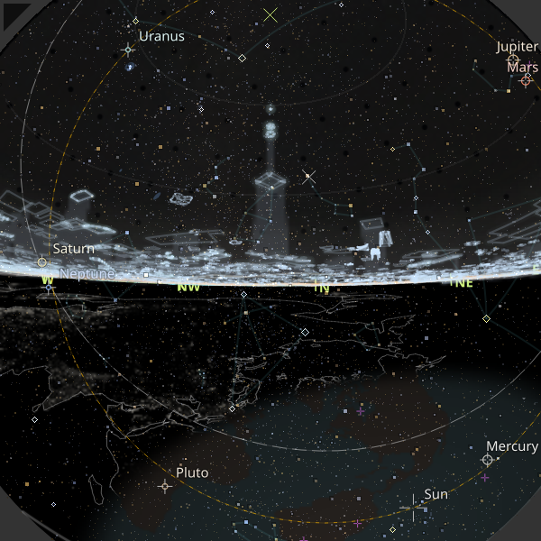
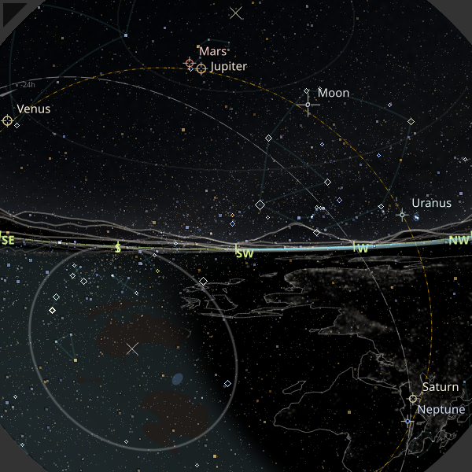
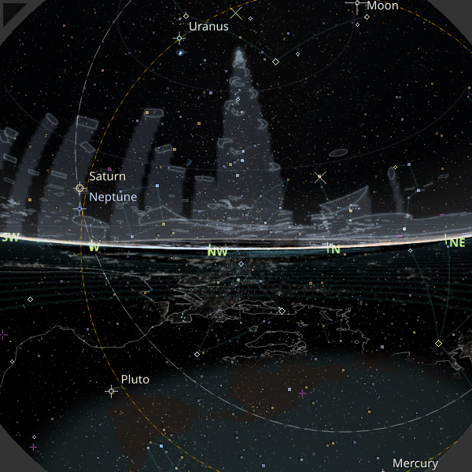
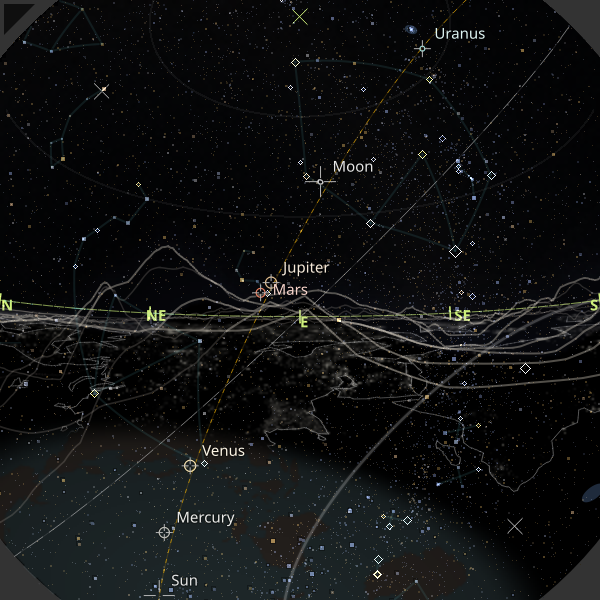
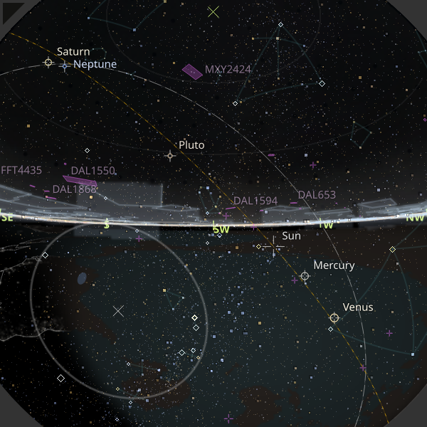
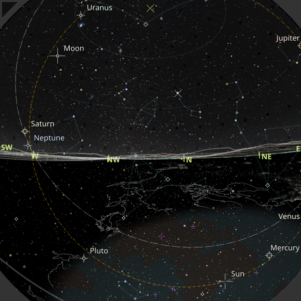
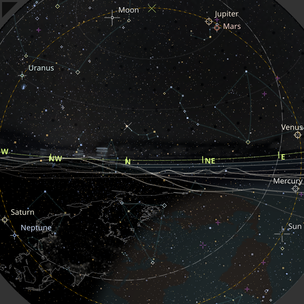

# zstarview スクリーンショットギャラリー

世界各地の都市アウトラインと地形地平線の例を示す画像です。これらの PNG は GUI のスクリーンショットではなく、`zstarview-export-image` の出力です。場所・時刻・視線方向のメタデータは PNG のテキストチャンクに埋め込まれており、`exiftool` などで確認できます。

<table>
  <tr>
    <td align="center" width="25%"></td>
    <td align="center" width="25%"></td>
    <td align="center" width="25%"></td>
    <td align="center" width="25%"></td>
  </tr>
  <tr>
    <td align="center">サーキュラー・キー（シドニー）</td>
    <td align="center">東京タワー付近（東京）</td>
    <td align="center">山中湖から望む富士山</td>
    <td align="center">出雲大社（島根）</td>
  </tr>
  <tr>
    <td align="center"></td>
    <td align="center"></td>
    <td align="center"></td>
    <td align="center"></td>
  </tr>
  <tr>
    <td align="center">台北101（台湾）</td>
    <td align="center">マリーナベイ（シンガポール）</td>
    <td align="center">ブルジュ・ハリファ付近（ドバイ）</td>
    <td align="center">マナローラ（イタリア）</td>
  </tr>
  <tr>
    <td align="center"></td>
    <td align="center"></td>
    <td align="center"></td>
    <td align="center"></td>
  </tr>
  <tr>
    <td align="center">ユングフラウヨッホ（Jungfraujoch、スイス）</td>
    <td align="center">サグラダファミリア（バルセロナ）</td>
    <td align="center">ウェストミンスター橋（ロンドン）</td>
    <td align="center">ウユニ塩湖（ボリビア）</td>
  </tr>
  <tr>
    <td align="center"></td>
    <td align="center"></td>
    <td align="center"></td>
    <td></td>
  </tr>
  <tr>
    <td align="center">アトランタ（ジョージア州）</td>
    <td align="center">Bliss の丘（カリフォルニア）</td>
    <td align="center">マウナケア（ハワイ）</td>
    <td></td>
  </tr>
</table>

注記: 一部のスクリーンショットでは PLATEAU データを使用しています。詳細は
[PLATEAU 建物データの準備](../README_ja-JP.md#plateau-building-data-preparation) を参照してください。
