# zstarview スクリーンショットギャラリー

これらのスクリーンショットは以前のバージョンの zstarview で撮影したものです。
現在の描画とは細部が異なる場合があります。

> 注意: 以下のスクリーンショットでは、インストールのセクションでオプションとしている「海岸線データ」「都市アウトラインデータ」「AKARI IR bands データ」を有効にしています。

<table>
  <tr>
    <td valign="top" width="33%">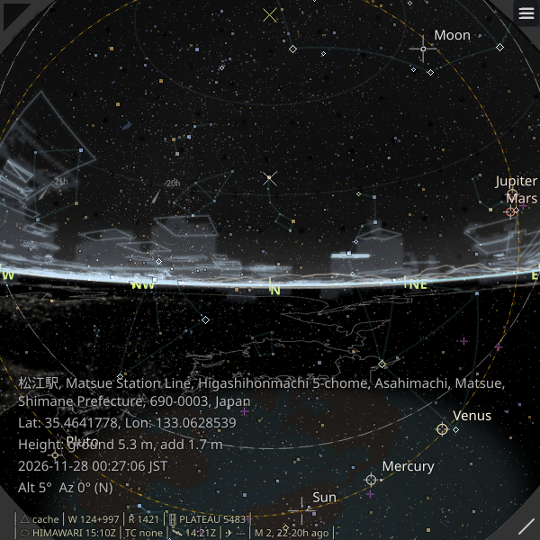</td>
    <td valign="top">
<code>zstarview -p "Matsue Station" -A5 -Znw -a0.4 -P0.4</code> で表示した、日本の一都市の夜空です。恒星 Vega のあたりにマウスをホバーしているため、この星が属するアステリズムの Summer Triangle が表示されています。建物は <em>urban outline</em> として表示されています。

画面右側には雲が表示され、円形のドットを並べたハーフトーンで表現されています。雲は、GOES や Himawari などの衛星データから推定した雲量をもとに描画しています。

建物のデータは基本的には Overture Maps から取得しますが、日本の都市のいくつかについては、<a href="../README_ja-JP.md#plateau-building-data-preparation">PLATEAU のデータ</a>も利用可能です。このスクリーンショットでは PLATEAU のデータを利用しています。
</td>
  </tr>
</table>

<table>
  <tr>
    <td valign="top" width="33%">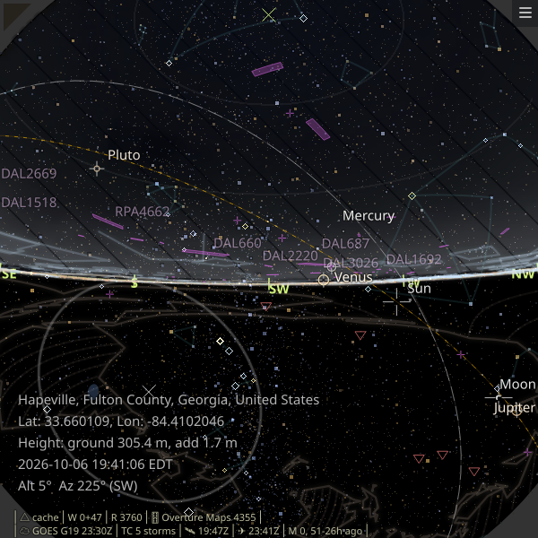</td>
    <td valign="top">
アトランタ空港とその上空の画面で、忙しい空域を飛ぶ10機以上の航空機が表示されています。航空機の軌跡は紫色のリボンで描かれ、地平線の下にある楕円は <em>never-rises</em>（昇らない領域）、つまり天球上で水平線より上に来ることがない領域を示しています。天の赤道と黄道は点線の基準線として表示されています。

天の赤道は、天の北極と天の南極を結ぶ地軸を法線とする大円です。never-rises の境界は、同じ地軸を中心軸とする小円です。

注意: 航空機をリボンとして表示するには、CLI では <code>-a 0.4</code> などを指定してください。<code>zstarview-gui</code> では、起動時のダイアログの <code>Overlays</code> タブで <code>Aircraft opacity</code> を 0.4 などに設定してください。
</td>
  </tr>
</table>

<table>
  <tr>
    <td valign="top" width="33%">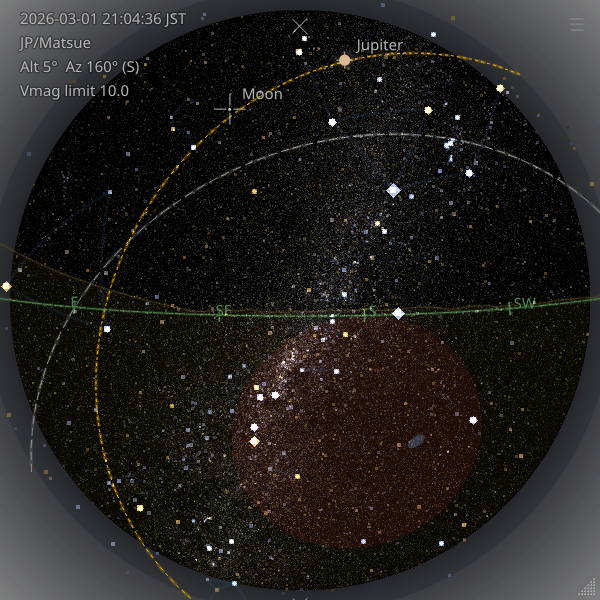</td>
    <td valign="top">
世界で最も平らな場所の一つとして知られているユウニ塩湖から、天頂を見上げた画面です。周囲をぐるっと囲む水平線は、地平線の高低差がほとんどないため、ほぼ円形に描かれています。<code>-V9</code> により、視等級 9 までの恒星を表示しています。また、<code>-s5</code> により、小さな恒星を目立たせるため、デフォルトより少し大きめに恒星を表示しています。

注意: 等級上限を大きくすると描画時間も増えます。<a href="cli-celestial-ja_JP.md#about-magnitude-limit">等級上限オプションについて</a>も参照してください。
</td>
  </tr>
</table>

<table>
  <tr>
    <td valign="top" width="33%">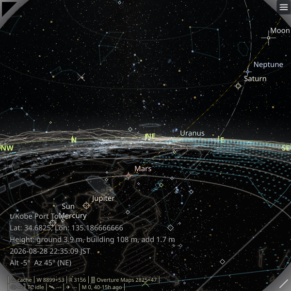</td>
    <td valign="top">
地表から 108m の高さにあるタワーから、視線方向の高度を少し下向き（<code>-A-5</code>、-5 度）にした画面です。Kobe Port Tower のように、いくつかのタワーは内部データベースに場所と高さが登録されています。利用可能なタワー名は <code>--list-viewpoints t</code> で、山名は <code>--list-viewpoints m</code> で一覧表示できます。この画面では、<em>night light</em>（宇宙から見た地表の明るさのデータ）によって地面が光る効果も付けています。これにより、都市の部分と海の部分で明るさが異なって見えます。
</td>
  </tr>
</table>

<table>
  <tr>
    <td valign="top" width="33%">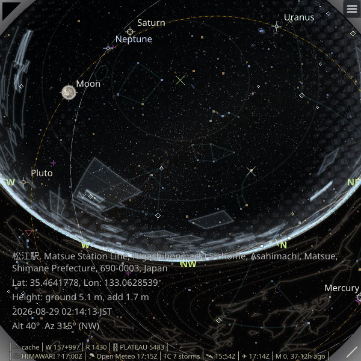</td>
    <td valign="top">
視線方向の高度を変更するオプションに <code>-A40</code> を指定し、空を見上げた状況を示しています。FOV は画面の端で 90 度になるため、少し魚眼レンズのような効果が現れます。月は画面の左上側に表示されています。

月の上にマウスを移動すると、月が通常の見かけの大きさの 5 倍に拡大されます。通常の動作では、表示時刻に対応する月のシミュレーション画像を NASA Scientific Visualization Studio の Dial-A-Moon API から取得します。このシミュレーション画像には、影として月の位相が含まれています。

デフォルトの明るい天体モードでは、通常サイズの月は明るい側の外周弧と明暗境界の弧による月相アウトラインで表示されます。視等級に応じて描かれる恒星や惑星とは異なり、月は見かけの角直径を基準に円盤として描かれます。
</td>
  </tr>
</table>

<table>
  <tr>
    <td valign="top" width="33%">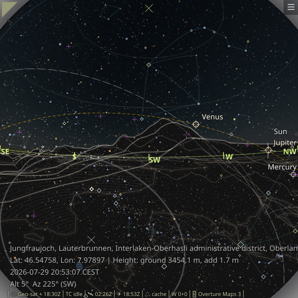</td>
    <td valign="top">
スイスの山岳地帯を表示した画面で、切り立った地形が水平線付近に見えています。太陽が地平線より上にあるため、空には色が付いています。稜線はオリーブ色で描かれています。

雲の描画については、ヨーロッパの大部分は GOES や Himawari の衛星のカバー範囲外なので、デフォルトでは雲は描かれません。<code>--geo-satellite true</code> を指定すると、静止衛星の雲画像を加工して表示する実験的なサポートを利用できます。
</td>
  </tr>
</table>

<table>
  <tr>
    <td valign="top" width="33%">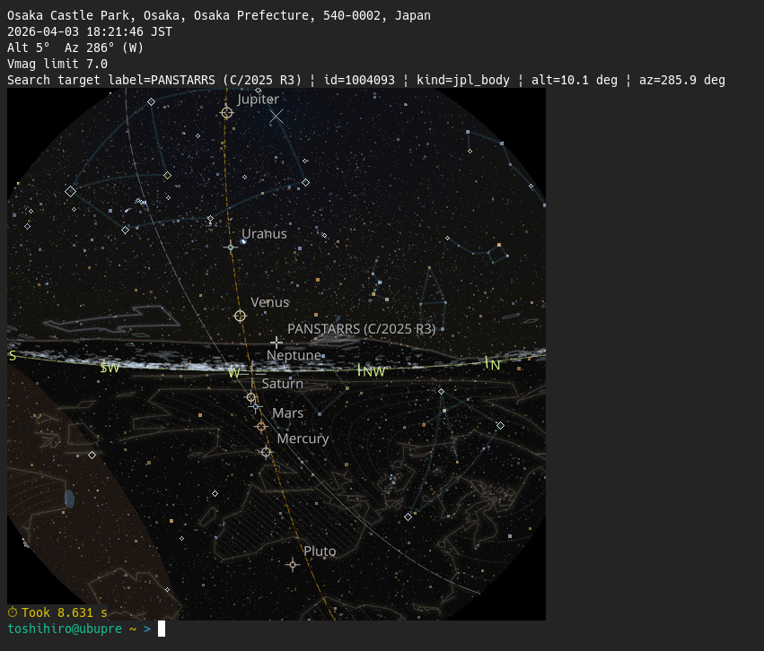</td>
    <td valign="top">
GUI アプリではなく <code>zstarview-export-image</code> を用いて出力した星空画像です。オブジェクトの検索オプション <code>--search "Torifune"</code> を利用して、小天体の位置を表示しています。右側には日本の建物、大阪城も見えています。
</td>
  </tr>
</table>

<table>
  <tr>
    <td valign="top" width="33%">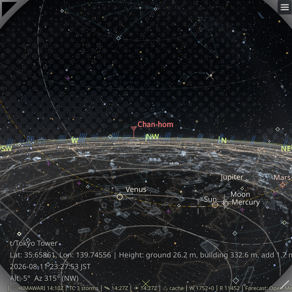</td>
    <td valign="top">
この画面では、東京近辺を移動する台風を表示しています。赤いマーカーが台風を、青い斜めの線がモデルによって予測された降水量を示します。雲などの観測に基づくレイヤーとは異なり、この予測は実際の降水と異なることがあります。予測降水量の多さは線の本数で表現しています。

降水量表示は、<code>--precipitation-opacity</code> に0以外の値を指定すると有効になります。初めて有効にするときは、Open-Meteo Free APIの利用条件への同意が必要です。
</td>
  </tr>
</table>

<table>
  <tr>
    <td valign="top" width="33%">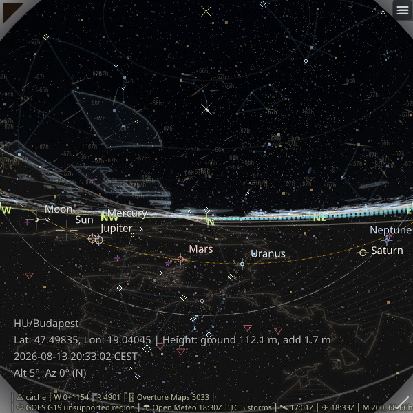</td>
    <td valign="top">
この画面では、ブダペスト上空で観測された Global Meteor Network の流星軌跡を表示しています。軌跡は観測時に記録された方向に描画され、明るく先細りする流星の経路と、<code>-56h</code> や <code>-67h</code> のような経過時間ラベルが表示されます。ペルセウス座流星群の時期に撮影されたため、特に多くの軌跡が表示されています。

流星軌跡は、<code>--meteor-trails-opacity</code> に正の値を指定すると有効になります。<code>--meteor-trails-max-candidates</code> で表示する軌跡数を制限できます。
</td>
  </tr>
</table>

その他のスクリーンショット

世界各地の都市アウトラインと地形地平線の例を示す画像です。これらの PNG は GUI のスクリーンショットではなく、`zstarview-export-image` の出力です。場所・時刻・視線方向のメタデータは PNG のテキストチャンクに埋め込まれており、`exiftool` などで確認できます。

<table>
  <tr>
    <td align="center" width="25%">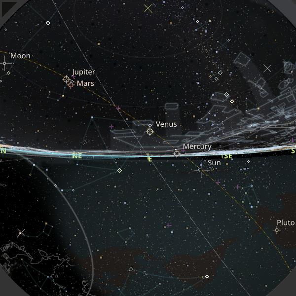</td>
    <td align="center" width="25%"></td>
    <td align="center" width="25%">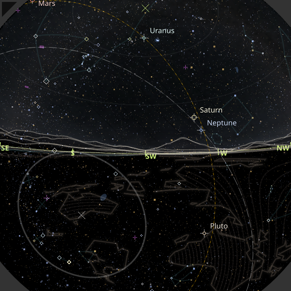</td>
    <td align="center" width="25%">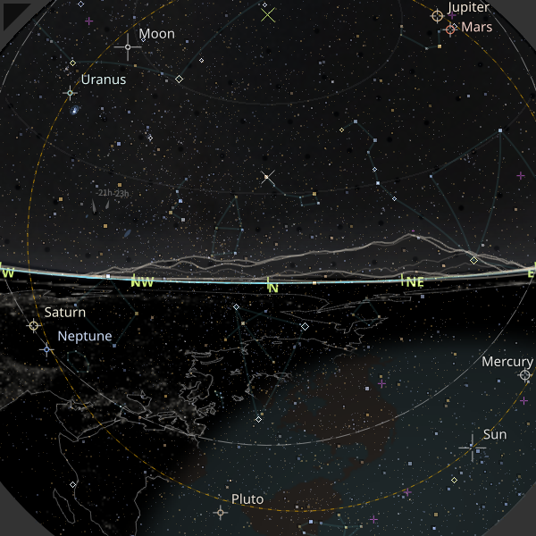</td>
  </tr>
  <tr>
    <td align="center">サーキュラー・キー（シドニー）</td>
    <td align="center">東京タワー付近（東京）</td>
    <td align="center">山中湖から望む富士山</td>
    <td align="center">出雲大社（島根）</td>
  </tr>
  <tr>
    <td align="center">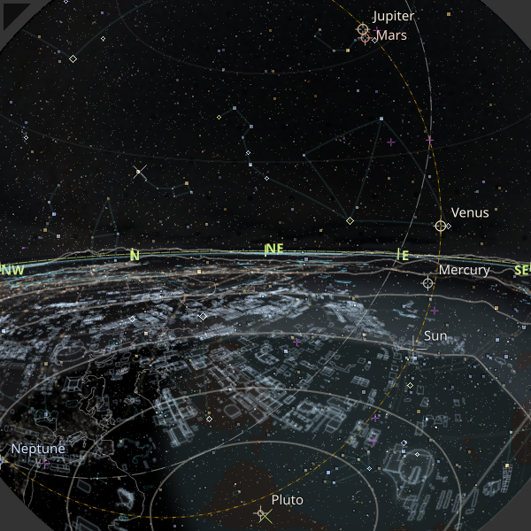</td>
    <td align="center">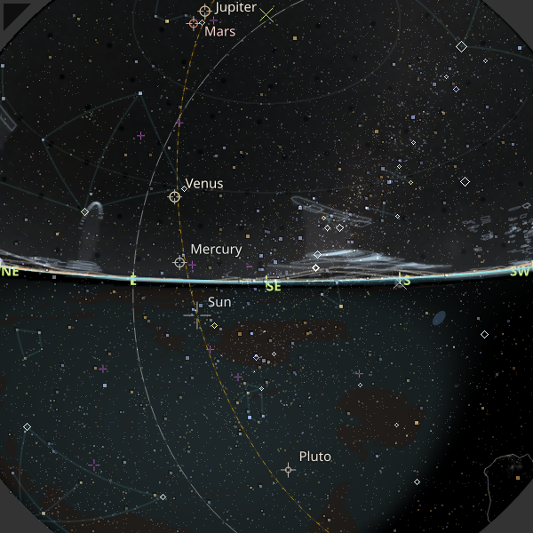</td>
    <td align="center"></td>
    <td align="center">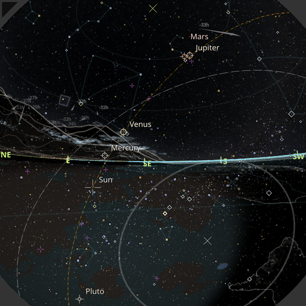</td>
  </tr>
  <tr>
    <td align="center">台北101（台湾）</td>
    <td align="center">マリーナベイ（シンガポール）</td>
    <td align="center">ブルジュ・ハリファ付近（ドバイ）</td>
    <td align="center">マナローラ（イタリア）</td>
  </tr>
  <tr>
    <td align="center">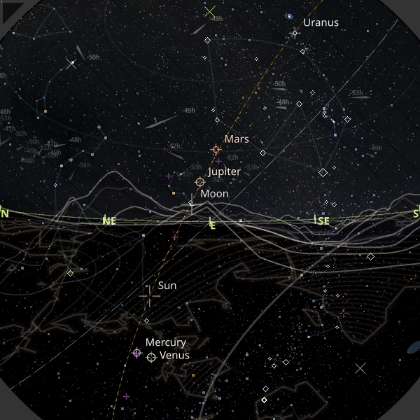</td>
    <td align="center">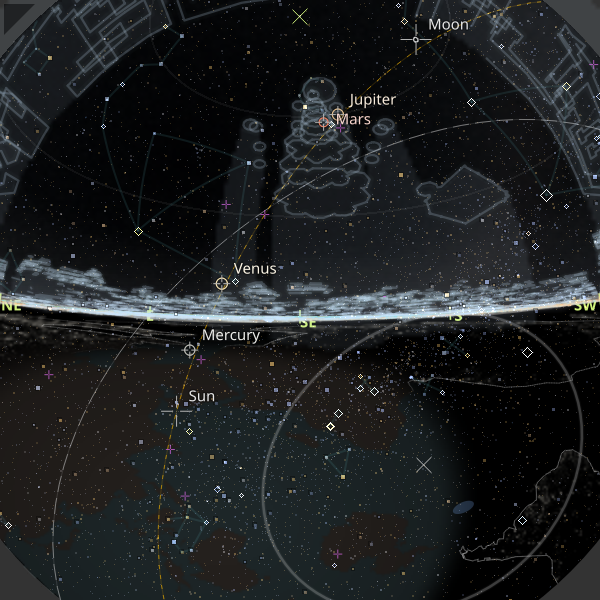</td>
    <td align="center">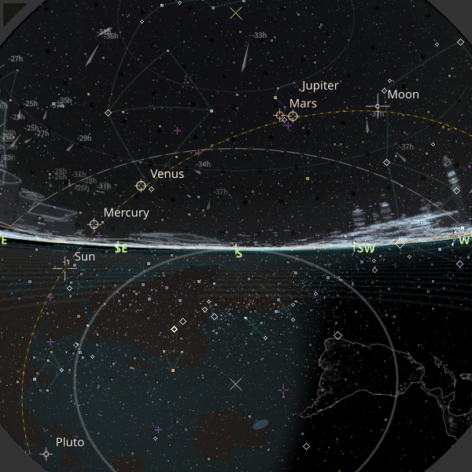</td>
    <td align="center">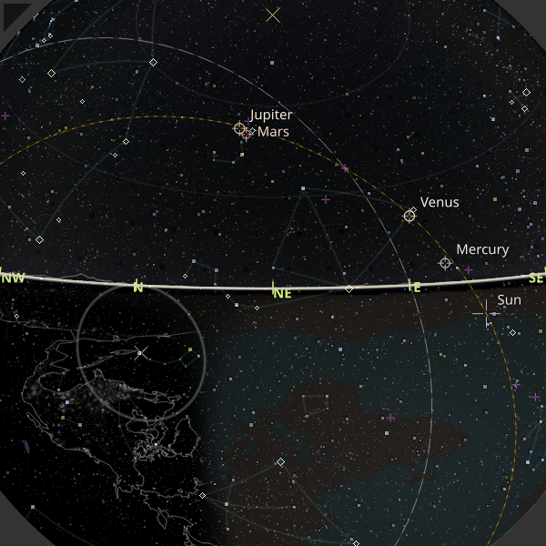</td>
  </tr>
  <tr>
    <td align="center">ユングフラウヨッホ（Jungfraujoch、スイス）</td>
    <td align="center">サグラダファミリア（バルセロナ）</td>
    <td align="center">ウェストミンスター橋（ロンドン）</td>
    <td align="center">ユウニ塩湖の別の画像（ボリビア）</td>
  </tr>
  <tr>
    <td align="center">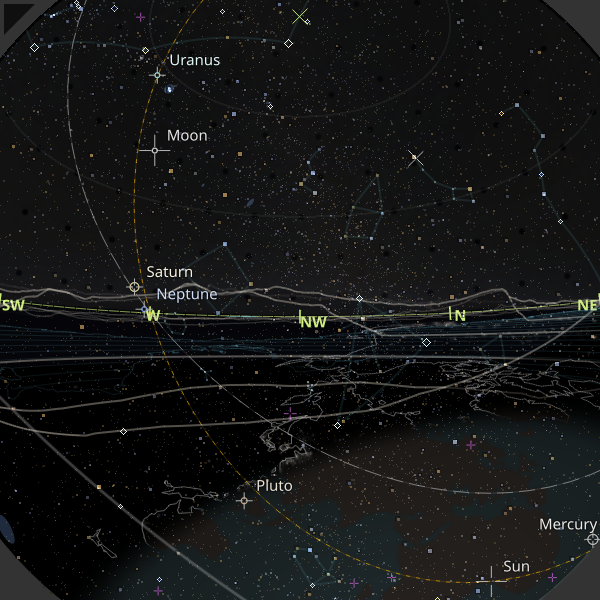</td>
    <td align="center"></td>
    <td colspan="2"></td>
  </tr>
  <tr>
    <td align="center">ウィザード島（オレゴン）</td>
    <td align="center">Bliss の丘（カリフォルニア）</td>
    <td colspan="2"></td>
  </tr>
</table>

注記: 一部のスクリーンショットでは PLATEAU データを使用しています。詳細は
[PLATEAU 建物データの準備](../README_ja-JP.md#plateau-building-data-preparation) を参照してください。

