# zstarview Screenshot Gallery

These screenshots were taken with earlier versions of zstarview, so some
details of the current rendering may differ.

> Note: The screenshots below have the optional coastline data and
> urban outline data and AKARI IR bands data described in the Installation
> section enabled.

<table>
  <tr>
    <td valign="top" width="33%">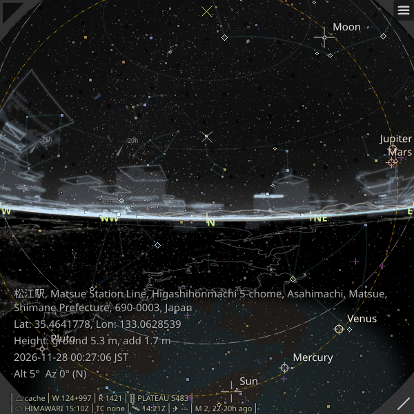</td>
    <td valign="top">
This view shows the night sky over a Japanese city, displayed with <code>zstarview -p "Matsue Station" -A5 -Znw -a0.4 -P0.4</code>. The mouse is hovering near Vega, so the asterism it belongs to, the Summer Triangle, is shown. Buildings are displayed as an <em>urban outline</em>.

Clouds are visible on the right side of the image, rendered as a halftone pattern of circular dots. Clouds are rendered from cloud amounts estimated from satellite data such as GOES and Himawari.

Building data is generally obtained from Overture Maps, but <a href="../README.md#plateau-building-data-preparation">PLATEAU data</a> is also available for some Japanese cities. This screenshot uses PLATEAU data.
</td>
  </tr>
</table>

<table>
  <tr>
    <td valign="top" width="33%">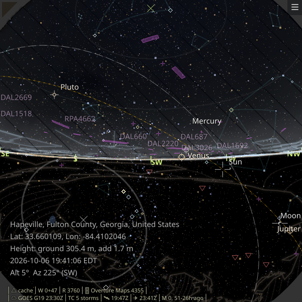</td>
    <td valign="top">
This view shows Atlanta airport and the busy airspace above it, with more than ten aircraft visible. Aircraft trails are rendered as purple ribbons, and the ellipse below the horizon marks the <em>never-rises</em> region: the part of the celestial sphere that never comes above the horizon. The celestial equator and ecliptic are shown as dashed reference lines.

The celestial equator is a great circle whose normal axis is the Earth's rotation axis, the line connecting the north and south celestial poles. The never-rises boundary is a smaller circle around the same axis.

Note: To display aircraft as ribbons, specify <code>-a 0.4</code> or another opacity value in the CLI. In <code>zstarview-gui</code>, set <code>Aircraft opacity</code> to 0.4 or another value in the <code>Atmosphere</code> tab of the startup dialog.
</td>
  </tr>
</table>

<table>
  <tr>
    <td valign="top" width="33%">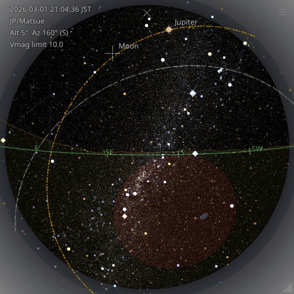</td>
    <td valign="top">
This view looks straight up from Salar de Uyuni, known as one of the flattest places in the world. The horizon forms an almost complete circle around the view because the difference in elevation along the horizon is very small. The <code>-V9</code> option displays stars down to visual magnitude 9, while <code>-s5</code> makes the stars slightly larger than the default so that the smaller stars stand out.

Note: higher magnitude limits increase rendering time. See <a href="cli-celestial.md#about-magnitude-limit">About magnitude limit</a>.
</td>
  </tr>
</table>

<table>
  <tr>
    <td valign="top" width="33%">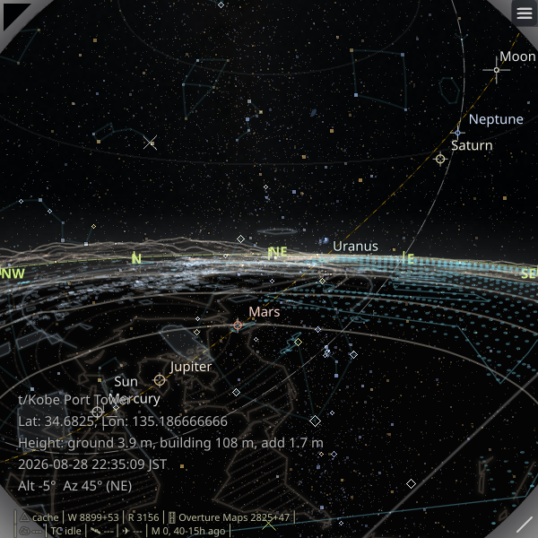</td>
    <td valign="top">
This view is from a tower 108 meters above the ground, with the viewing altitude lowered slightly to <code>-A-5</code> degrees. Some towers, such as Kobe Port Tower, have their locations and heights registered in the internal database. Use <code>--list-viewpoints t</code> to list the available tower names, or <code>--list-viewpoints m</code> to list the available mountain names. This view also uses <em>night lights</em>, a dataset of the brightness of the ground as seen from space, which makes the ground glow differently over urban and sea areas.
</td>
  </tr>
</table>

<table>
  <tr>
    <td valign="top" width="33%">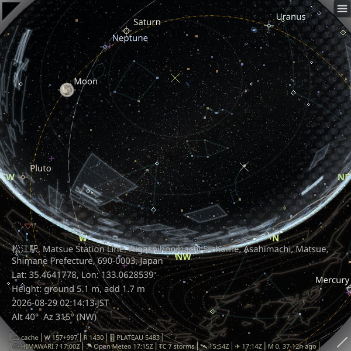</td>
    <td valign="top">
This view uses <code>-A40</code> to change the altitude of the viewing direction and shows a view looking upward into the sky. The field of view reaches 90 degrees at the edge of the screen, producing a subtle fisheye-lens effect. The Moon is displayed in the upper-left part of the image.

The Moon is enlarged to 5x its normal apparent size after the mouse is moved over it. During normal operation, a simulated Moon image for the display time is fetched from NASA Scientific Visualization Studio's Dial-A-Moon API. The simulation includes the Moon's phase as the shadowed portion of the image.

In the default bright-body mode, the normal Moon marker uses a compact phase-aware outline. Unlike stars and planets, which are drawn according to visual magnitude, the Moon is rendered as a disk using its apparent angular size.
</td>
  </tr>
</table>

<table>
  <tr>
    <td valign="top" width="33%">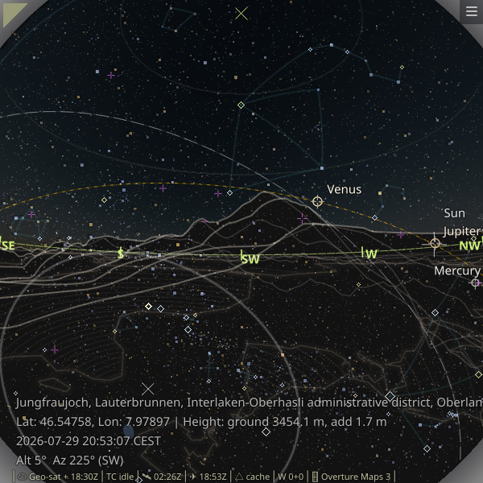</td>
    <td valign="top">
This view shows a mountainous region of Switzerland, where steep terrain is visible along the horizon. Because the Sun is above the horizon, the sky is colored rather than fully dark. Terrain ridges are drawn in olive.

For cloud rendering, most of Europe is outside the coverage of GOES and Himawari, so clouds are not drawn by default. Experimental support is available through <code>--geo-satellite true</code>, which processes cloud imagery from a geostationary satellite.
</td>
  </tr>
</table>

<table>
  <tr>
    <td valign="top" width="33%">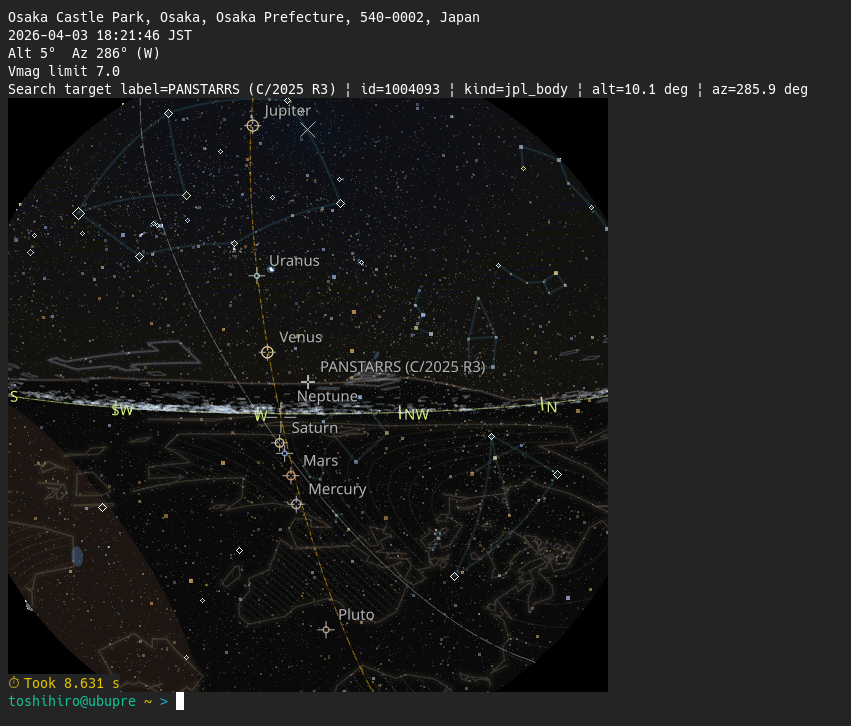</td>
    <td valign="top">
This view is a star-field image generated with <code>zstarview-export-image</code>, rather than a GUI application screenshot. The object search option <code>--search "Torifune"</code> is used to show the position of the minor body. Osaka Castle, a Japanese building, is visible on the right.
</td>
  </tr>
</table>

<table>
  <tr>
    <td valign="top" width="33%">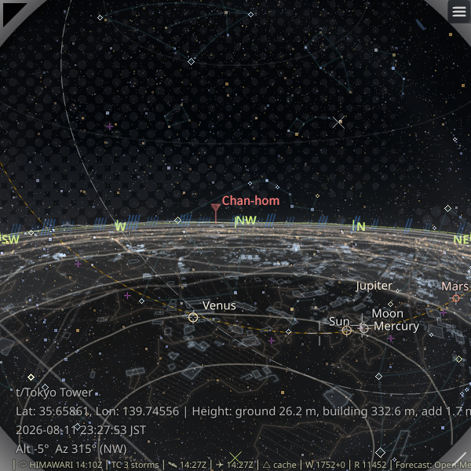</td>
    <td valign="top">
This view shows a typhoon moving near Tokyo. The red marker shows the typhoon, and the blue diagonal lines show precipitation predicted by a forecast model. Unlike observation-based layers such as clouds, this forecast may differ from the precipitation that actually occurs. The number of lines represents the forecast amount of precipitation.

Forecast precipitation is enabled by setting <code>--precipitation-opacity</code> to a positive value. The first time it is enabled, you must agree to the Open-Meteo Free API terms.
</td>
  </tr>
</table>

<table>
  <tr>
    <td valign="top" width="33%">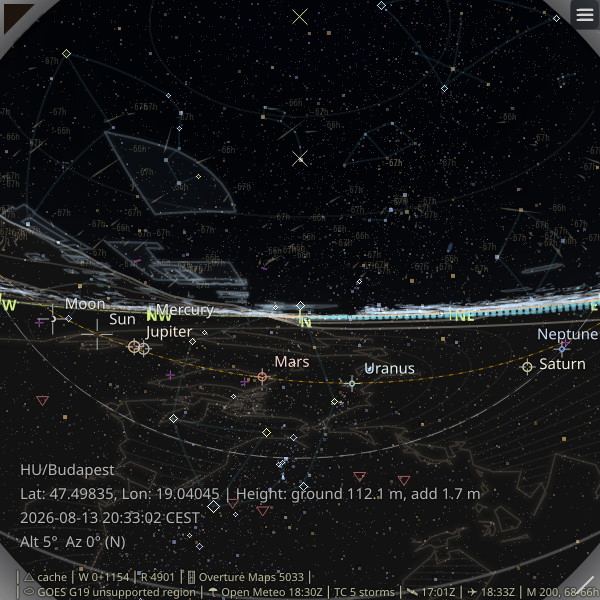</td>
    <td valign="top">
This view shows observed Global Meteor Network meteor trails over Budapest. The trails are drawn in the directions recorded at observation time, with brighter tapered marks for the meteor paths and compact age labels such as <code>-56h</code> and <code>-67h</code>. The image was captured during the Perseid meteor shower, so an especially large number of trails is visible.

Meteor trails are enabled with a positive <code>--meteor-trails-opacity</code> value. Use <code>--meteor-trails-max-candidates</code> to limit the number of displayed trails.
</td>
  </tr>
</table>

Other screenshots

These screenshots show urban outline and terrain horizon examples from several places worldwide. They are `zstarview-export-image` outputs, not GUI screenshots, and they carry location/time/view metadata in embedded PNG text chunks that tools such as `exiftool` can inspect:

<table>
  <tr>
    <td align="center" width="25%">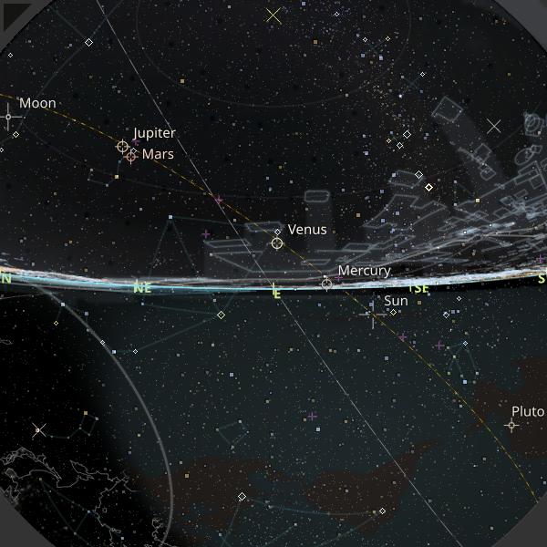</td>
    <td align="center" width="25%">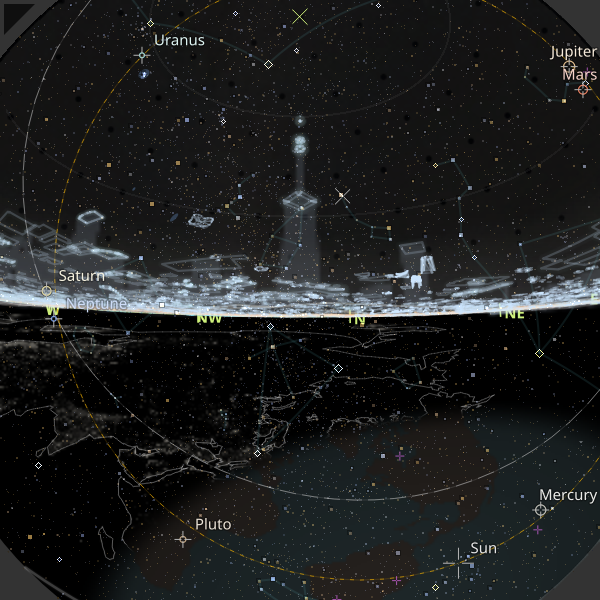</td>
    <td align="center" width="25%"></td>
    <td align="center" width="25%">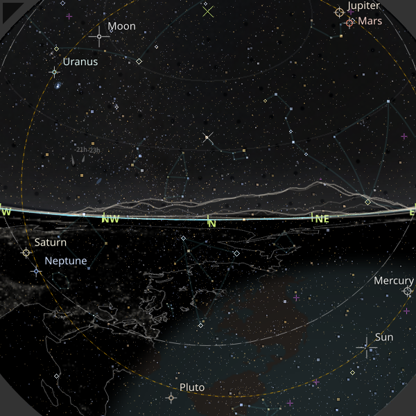</td>
  </tr>
  <tr>
    <td align="center">Circular Quay, Sydney</td>
    <td align="center">Near Tokyo Tower, Tokyo</td>
    <td align="center">View of Mt. Fuji, Japan</td>
    <td align="center">Izumo Taisha, Japan</td>
  </tr>
  <tr>
    <td align="center"></td>
    <td align="center"></td>
    <td align="center">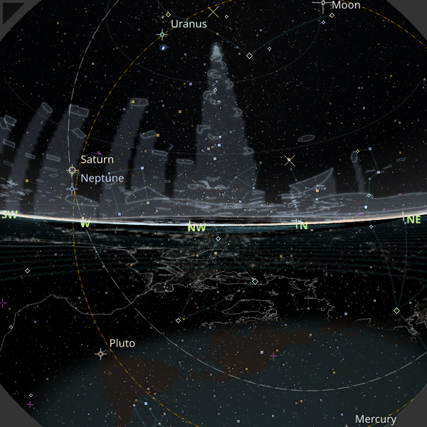</td>
    <td align="center">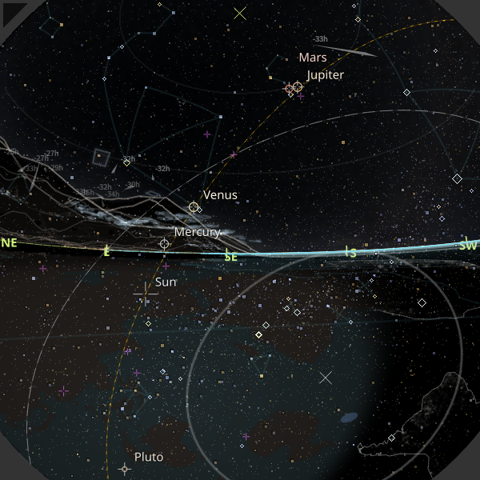</td>
  </tr>
  <tr>
    <td align="center">Taipei 101, Taiwan</td>
    <td align="center">Marina Bay, Singapore</td>
    <td align="center">Near Burj Khalifa, Dubai</td>
    <td align="center">Manarola, Italy</td>
  </tr>
  <tr>
    <td align="center"></td>
    <td align="center"></td>
    <td align="center">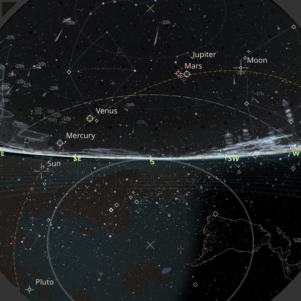</td>
    <td align="center">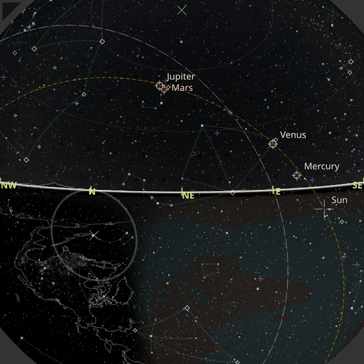</td>
  </tr>
  <tr>
    <td align="center">Jungfraujoch, Switzerland</td>
    <td align="center">Sagrada Familia, Barcelona</td>
    <td align="center">Westminster Bridge, London</td>
    <td align="center">Alternate view of Salar de Uyuni, Bolivia</td>
  </tr>
  <tr>
    <td align="center">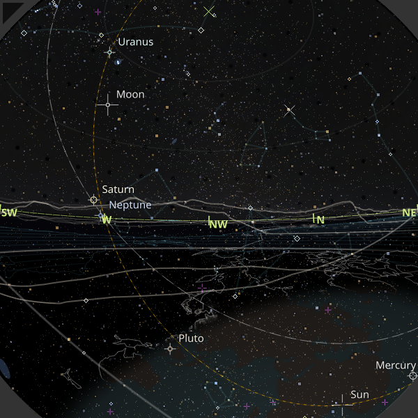</td>
    <td align="center">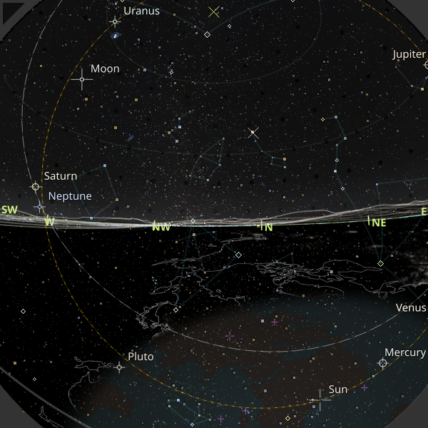</td>
    <td colspan="2"></td>
  </tr>
  <tr>
    <td align="center">Wizard Island, Oregon</td>
    <td align="center">Bliss hill, California</td>
    <td colspan="2"></td>
  </tr>
</table>

Note: Some of these screenshots use PLATEAU data. See [PLATEAU Building Data Preparation](../README.md#plateau-building-data-preparation) for details.

