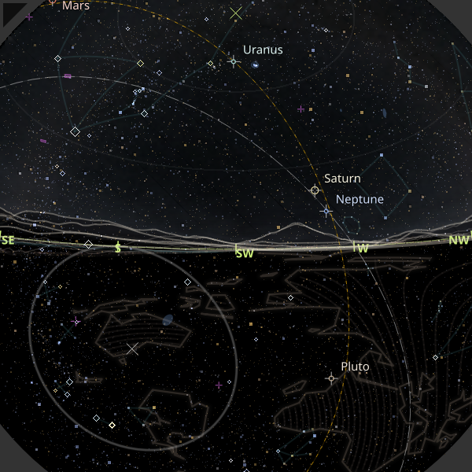
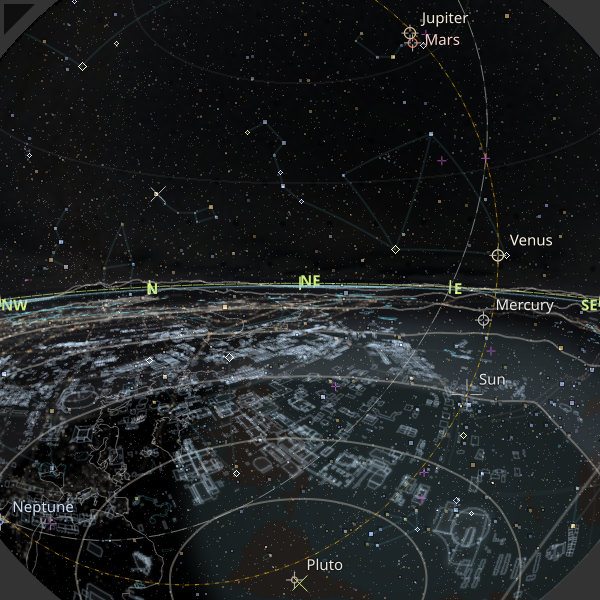
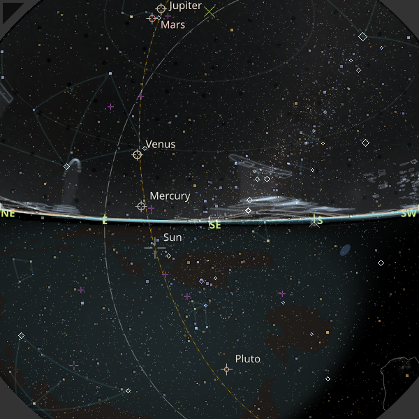
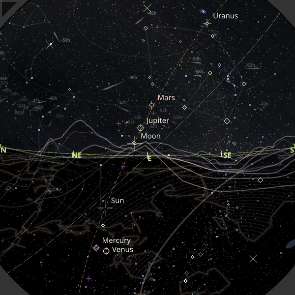
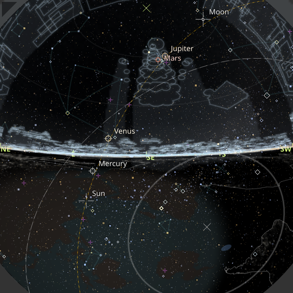

# zstarview Screenshot Gallery

These images were generated with earlier versions of zstarview, so some details of the current rendering may differ.

These screenshots show urban outline and terrain horizon examples from several places worldwide. They are `zstarview-export-image` outputs, not GUI screenshots, and they carry location/time/view metadata in embedded PNG text chunks that tools such as `exiftool` can inspect:

<table>
  <tr>
    <td align="center" width="25%"></td>
    <td align="center" width="25%"></td>
    <td align="center" width="25%"></td>
    <td align="center" width="25%"></td>
  </tr>
  <tr>
    <td align="center">Circular Quay, Sydney</td>
    <td align="center">Near Tokyo Tower, Tokyo</td>
    <td align="center">View of Mt. Fuji, Japan</td>
    <td align="center">Izumo Taisha, Japan</td>
  </tr>
  <tr>
    <td align="center"></td>
    <td align="center"></td>
    <td align="center"></td>
    <td align="center"></td>
  </tr>
  <tr>
    <td align="center">Taipei 101, Taiwan</td>
    <td align="center">Marina Bay, Singapore</td>
    <td align="center">Near Burj Khalifa, Dubai</td>
    <td align="center">Manarola, Italy</td>
  </tr>
  <tr>
    <td align="center"></td>
    <td align="center"></td>
    <td align="center"></td>
    <td align="center"></td>
  </tr>
  <tr>
    <td align="center">Jungfraujoch, Switzerland</td>
    <td align="center">Sagrada Familia, Barcelona</td>
    <td align="center">Westminster Bridge, London</td>
    <td align="center">Alternate view of Salar de Uyuni, Bolivia</td>
  </tr>
  <tr>
    <td align="center"></td>
    <td align="center"></td>
    <td colspan="2"></td>
  </tr>
  <tr>
    <td align="center">Wizard Island, Oregon</td>
    <td align="center">Bliss hill, California</td>
    <td colspan="2"></td>
  </tr>
</table>

Note: Some of these screenshots use PLATEAU data. See [PLATEAU Building Data Preparation](../README.md#plateau-building-data-preparation) for details.
